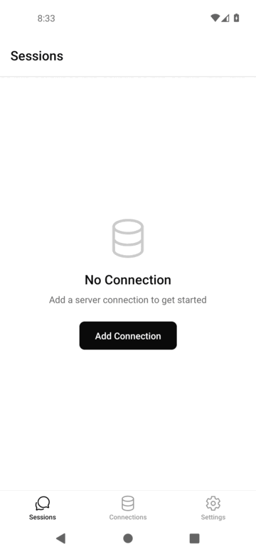

# NodRun Exclusive SHΞN™ made mobile teminal Agent

**The open-source Android client for the [opencode](https://github.com/sst/opencode) AI coding agent.**
AI-assisted coding from your phone — Android, via Google Play, F-Droid, or a direct APK.

[](LICENSE)
[](https://github.com/aishervin/NodRun/releases/latest)

> **Not affiliated with opencode.** NodRun Mobile is an independent, community-built client and is
> not made by, endorsed by, or affiliated with the opencode / Anomaly team. It talks to an opencode
> server you run yourself, using opencode's open HTTP API.

---

**New: tap "Try a Demo" in the app to see the agent fix a real bug — reasoning, a grep, a diff, a permission prompt — in about 30 seconds, no server needed.**

---

## Install (Android)

There are **two working ways** to install NodRun Mobile today, all for Android:

1. **F-Droid (self-hosted repo)** — add our self-hosted repo to any F-Droid client, then install/update from there:
   ```
   https://aishervin.github.io/NodRun/fdroid/repo
   ```
   In the F-Droid app: **Settings → Repositories → + (add)** and paste the URL above.

2. **Direct signed APK** — download the latest release and install it manually:
   **https://github.com/aishervin/NodRun/releases/latest**

---

NodRun Mobile is a React Native / Expo app that brings the power of the [opencode](https://github.com/sst/opencode) AI coding agent to your phone. Connect to your own self-hosted opencode server over your local network, a Cloudflare Tunnel, ngrok, or Tailscale — and write, review, and ship code from anywhere. The mobile client is **free and open-source** under the MIT license. There is no feature gate, no telemetry you did not opt into, and no ad network.

---

<p align="center">
  
</p>

<sub>Real on-device capture: add a connection, browse sessions, and watch the agent stream a response.</sub>

---

## Features

- **Offline demo mode** — tap "Try a Demo" to see a full bug-fix walkthrough (reasoning → grep → diff → permission prompt) with zero setup, right from the empty state
- **Multi-connection** — manage multiple opencode servers (local network, Cloudflare Tunnel, ngrok, or Tailscale)
- **Biometric unlock** — Face ID, Touch ID, or Android fingerprint protects the app and individual message sends
- **Streaming chat** — token-by-token streaming responses directly from your opencode server
- **Diff viewer** — inline side-by-side diffs of every file change the agent makes
- **Tool call approval** — review and approve (or reject) tool calls before the agent executes them
- **Secure credential storage** — server credentials stored in the Android Keystore via `expo-secure-store`
- **Session management** — browse, create, and resume coding sessions

---

## Quick Start

**Don't have a server yet?** Install the app and tap **Try a Demo** on the Sessions screen first — no setup required. It plays back a scripted bug-fix session through the app's real chat, diff, and permission-approval UI, offline, in about 30 seconds.

**Step 1 — Start opencode on your machine**

```bash
# Install opencode (if you haven't already)
npm install -g opencode-ai

# Run opencode in server mode
OPENCODE_SERVER_PASSWORD=yourpassword opencode serve --hostname 0.0.0.0 --port 4096
```

**Step 2 — Install NodRun Mobile** via [F-Droid, or a direct APK](#install-android).

**Step 3 — Add a connection in the app**

Open the app, tap **Add Connection**, and choose your connection type.
For Termux users: the app connects to `http://127.0.0.1:4096` by default.

---

## Get in touch
Developed by [SHΞN™](t.me/shervini)

---

## License

MIT — see [LICENSE](LICENSE).

Copyright (c) 2026 SHΞN™
